# Patchhaven

Patchhaven turns a Claude Code session into a living pixel-art work map. Claude
and the agent crew move between stations based on real file activity. Skills
and landmarks track the work you do together, with a compact OSRS-inspired feel
and a world shaped by your project.



Open Patchhaven with `/haven`. `/board` remains an alias.

## Install or update

For a fresh install from a terminal:

```bash
npx --yes @anthropic-ai/claude-code@2.1.309 plugin install task-board --marketplace xRampageous/patchhaven --scope user
```

To test the current Patchhaven v2 branch before it reaches the default branch:

```powershell
cd "C:\path\to\your\project"
npx --yes @anthropic-ai/claude-code@2.1.309 plugin install task-board --marketplace xRampageous/patchhaven#feat/patchhaven-v2 --scope project
```

After a new commit is pushed to that branch, update the project install:

```powershell
npx --yes @anthropic-ai/claude-code@2.1.309 plugin update task-board@claude-quest-hall --scope project
```

Then run `/reload-plugins` and reopen the pane with `/haven`.

The marketplace keeps the `claude-quest-hall` ID for existing installs. In
Claude Desktop, click **+** beside the prompt box, choose **Plugins**, add the
marketplace `xRampageous/patchhaven`, then install `task-board`.

The repository currently has no software license. Public visibility alone does
not grant permission to reuse or redistribute the code.

If you already installed the old Quest Hall plugin, update that same install:

```bash
npx --yes @anthropic-ai/claude-code@2.1.309 plugin update task-board@claude-quest-hall --scope user
```

The old marketplace name and `task-board` plugin ID stay in place so existing
installs can update through GitHub's repository redirect. The public project
and in-app name are Patchhaven. Coding XP carries over. The new skill ledger
starts earning XP from activity after this version is installed.

## The living map

The **Patch Trail** is one timber guild hall with a continuous wall and floor.
Its Patchboard is mounted on the wall, the hearth is where Claude rests between
turns, and the Terminal appears when shell work is running. Up to six file
districts use workstations that fit their role: coding desks, a test dummy and
check table, a reading nook, or the Forge anvil. Claude and the visible crew
move between these places; larger crews appear as a compact crowd count. Earned
landmarks light the hall's progress marks.

The HUD keeps your hero, Coding level, XP, edits, files and quest progress beside
the map. **Trail**, **Focus** and **Log** move between the project, a selected
worker's activity and the visit journal. The expandable **Crew** panel includes
every known agent task, including reviewers that have not reached a file yet.
It shows who is working, waiting between tools, running in the background,
waiting for approval, finished or failed, plus their last known location.
The floor plan adjusts to narrow panes, while the scale setting can enlarge the
map in wider panes.

## Three stages of progress

Real work earns persistent skill XP for **Crafting** (edits), **Research**
(distinct file reads and web research), **Verification** (successful checks) and
**Teamwork** (completed plans, commits and crew). Skills use the classic OSRS
level curve. Repeating the same activity earns less XP, and each skill has a
per-visit cap. Earned levels unlock wearable titles and relics shown on your
hero and in the Skills ledger.

Plans follow a readable quest lifecycle: active steps can complete, be replaced,
cancelled or pause when work is blocked. The Log records those outcomes beside
file activity, checks, commits, crew and XP. At the end of a visit, Patchhaven
keeps a short field report with touched files, successful and failed checks,
completed quests, crew activity, XP and newly earned landmarks. It stores
activity metadata, not prompts, tool arguments or source text. Detailed visit
history is bounded; earned progress remains.

The **More** view includes scale modes, motion and chime settings, diagnostics,
and token-free sample scenes for edits, crew activity, approvals, failures and
completed visits. A sample scene only changes what is displayed. Use **Return
live** to go back to your project.

Choose a wizard, knight, ranger or smith as your hero, give them a name and
equip any title you have earned. The rest of the crew rotates through the other
appearances.

## Commands

- `/haven` opens Patchhaven. `/board` is an alias.
- `/haven world`, `/haven focus`, `/haven journal`, `/haven skills` and
  `/haven settings` select a view.
- `/haven stats` (or `/haven recap`) shows this visit's progress.
- `/haven size auto|comfortable|large` sets map scale.
- `/haven demo idle|edit|crew|approval|failure|complete` previews a sample scene;
  `/haven demo off` returns to live activity.
- `/haven hero wizard|knight|ranger|smith` changes your hero; `/haven name
  <name>` sets the name.
- `/haven title <earned title>` equips a reward; `/haven title` lists rewards.
- `/haven replay` plays the selected journal visit; `/haven live` returns to the
  current scene.
- `/haven motion` toggles animation; `/haven sound` toggles chimes.
- `/haven plan` toggles whether Claude's step list appears in Patchhaven or
  under each message.
- `/haven help` lists commands. Every command also works under `/board`.

## Development

With Claude Code 2.1.309 or later, run the plugin checks from the repository
root:

```bash
npx --yes @anthropic-ai/claude-code@2.1.309 plugin test
npx --yes @anthropic-ai/claude-code@2.1.309 plugin validate . --strict
```

In Claude Desktop, open a project, use `/haven`, start work that reads and edits
files, then try a delegated background task. The **Crew** panel and the sample
scenes in **More** show how those activities appear on the map.

## Art

The hall, workstations and characters use original SVG and pixel-grid art. The
small chimes are synthesized bell tones.
