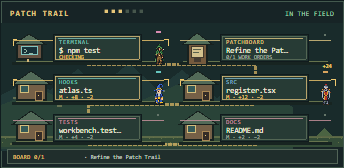

# Patchhaven

Patchhaven turns a Claude Code session into a compact pixel-art RPG map. Claude
walks between little work sites as files change, and the dotted trail links the
places visited during the session. The familiar agent-game feel stays in view;
the twist is that the world follows real folders, files, plans and background
agents.



Open Patchhaven with `/haven`. `/board` remains an alias.

## Install or update

For a fresh install from a terminal:

```bash
npx --yes @anthropic-ai/claude-code@2.1.309 plugin install task-board --marketplace xRampageous/patchhaven --scope user
```

To test the open Patchhaven v2 branch before it reaches the default branch:

```powershell
cd "C:\path\to\your\project"
npx --yes @anthropic-ai/claude-code@2.1.309 plugin install task-board --marketplace xRampageous/patchhaven#feat/patchhaven-v2 --scope project
```

After a new commit is pushed to that branch, update the project install:

```powershell
npx --yes @anthropic-ai/claude-code@2.1.309 plugin update task-board@claude-quest-hall --scope project
```

Then run `/reload-plugins` and reopen the pane with `/haven`.

The marketplace keeps the `claude-quest-hall` ID for existing installs.

In Claude Desktop, click **+** beside the prompt box, choose **Plugins**, add
the marketplace `xRampageous/patchhaven`, then install `task-board`.

The repository currently has no software license. Public visibility alone does
not grant permission to reuse or redistribute the code.

If you already installed the old Quest Hall plugin, update that same install:

```bash
npx --yes @anthropic-ai/claude-code@2.1.309 plugin update task-board@claude-quest-hall --scope user
```

The old marketplace name and `task-board` plugin ID stay in place so existing
installs can update through GitHub's repository redirect. The public project
and in-app name are Patchhaven. Your Coding XP carries over; the new journal
starts recording from your next session.

## The Patch Trail

The map is one connected field instead of a stack of room panels. Each changed
folder becomes a small work site, with the current file and change count on its
sign. Claude and up to three other agents move between those sites as activity
changes. A Terminal hut represents commands and searches, the Patchboard holds
the current plan, and new files appear in the Forge. Between turns Claude waits
at camp; background agents stay at their last known files.

The compact HUD keeps the hero, Coding level, XP, edit and file counts, quest
count and landmark progress close to the map. **Trail**, **Focus** and **Log**
switch between the whole work map, the active folder and a short visit journal.
The six permanent landmarks track meaningful milestones without adding daily
chores or rewards to claim.

The expandable **Crew** strip sits below the map. It lists every known agent
task, including reviewers that have not touched a file yet, with current status,
description and last known location. Running tasks stay visible after Claude's
foreground turn finishes; recent completed, failed and stopped tasks remain in
the list. The map itself stays compact and draws up to four characters at once.

## Progress and journal

Each project starts at camp. Meaningful work earns six permanent landmarks:
the Patch Garden, Patchboard, Signal Mast, Dispatch Pennant, Crew Camp and
Shared Workshop. Each has a clear activity goal and keeps a short evidence note
when earned. There are no daily chores or rewards that need claiming.

The **Log** records file names, edit counts, quest and check outcomes, commits,
crew activity and XP. It does not save prompts, tool input or source text. You
can browse the latest 24 visits and replay a visit as a read-only scene; replay
never runs tools or changes files. Older visits are pruned, while earned
landmarks remain.

Choose a wizard, knight, ranger or smith as your hero, give the hero a name,
and turn animation on or off. The rest of the crew rotates through the other
appearances.

## Commands

- `/haven` opens Patchhaven. `/board` is an alias.
- `/haven world`, `/haven focus`, `/haven journal` switch between Trail, Focus
  and Log views.
- `/haven stats` (or `/haven recap`) shows this visit's progress.
- `/haven hero wizard|knight|ranger|smith` changes your hero.
- `/haven name <name>` names your hero.
- `/haven replay` plays the selected journal visit; `/haven live` returns to
  the current scene.
- `/haven motion` toggles animation; `/haven sound` toggles permission and
  turn-end chimes.
- `/haven plan` toggles whether Claude's step list appears in Patchhaven or
  under each message.
- `/haven help` lists the commands. Every command also works under `/board`.

## Development

With Claude Code 2.1.309 or later, run the plugin checks from the repository
root:

```bash
npx --yes @anthropic-ai/claude-code@2.1.309 plugin test
npx --yes @anthropic-ai/claude-code@2.1.309 plugin validate . --strict
```

The tests use the local plugin harness and do not need a signed-in Claude
session. In Claude Desktop, open a project, use `/haven`, start work that reads
and edits files, then try a delegated background task and watch its status in
the Crew panel.

## Art

The terrain, work sites, camp and characters use original SVG and pixel-grid
art. The small chimes are synthesized bell tones.
